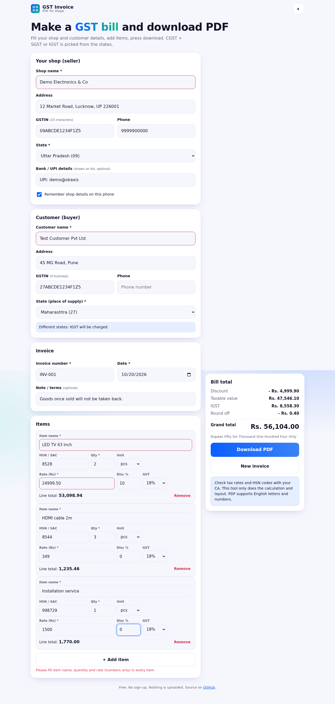
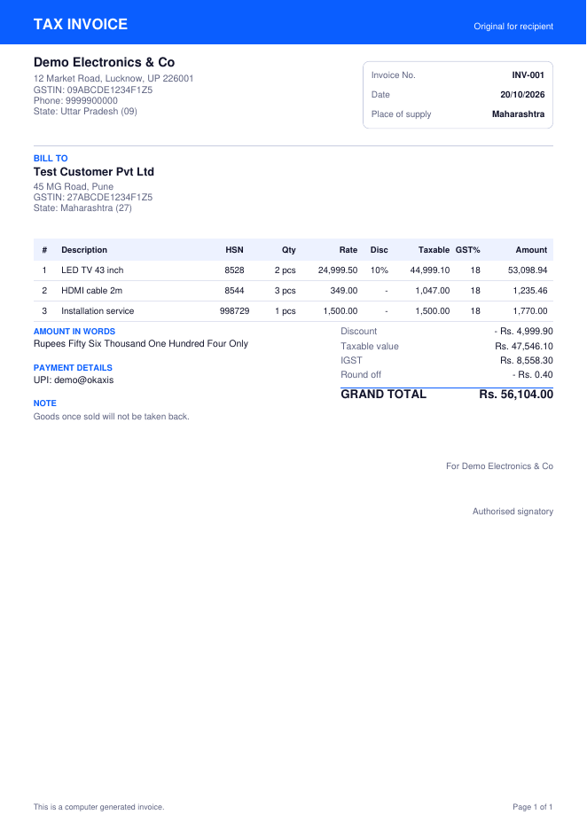
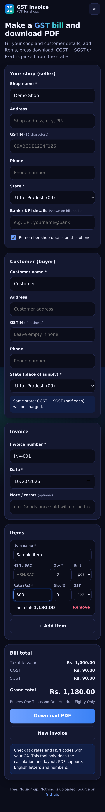

# GST Invoice PDF Generator

Make a **GST invoice** for your shop and download it as a clean **PDF**. Free, no sign-up, works on phone and desktop. Your data stays on your device.

**Live app:** https://akash991833.github.io/gst-invoice-pdf-generator/

| Form (desktop) | Sample PDF | Mobile (dark) |
|---|---|---|
|  |  |  |

## Features

- Seller and buyer details with **GSTIN check** (format + state code match)
- **CGST + SGST** for same state, **IGST** for different states, picked automatically
- Unlimited items: name, HSN/SAC, quantity, unit, rate, discount %, GST (0, 0.25, 3, 5, 12, 18, 28%)
- Live totals, round off, and **amount in words** (Indian system: lakh, crore)
- Bank / UPI details and a note on the bill
- A4 PDF with multi-page support for long invoices
- Invoice number goes up by itself (INV-001, INV-002...)
- Shop details are remembered on your device if you want
- Dark and light mode, installable as an app (PWA), works offline after first visit

## Privacy

No server, no upload, no tracking. Everything is calculated in your browser.

## Limits

- **Check tax rates and HSN codes with your CA.** The tool does the math and layout only. It does not know which GST rate applies to your item.
- The PDF supports English letters and numbers. Hindi text shows as "?" in the PDF (the app warns you).
- This is a simple invoice. No e-invoice (IRN / QR), e-way bill, cess, reverse charge or GST filing.
- Rupee amounts are printed as "Rs." in the PDF.

## Run it yourself

```bash
python3 -m http.server 8000     # open http://localhost:8000
node tests/calc-test.js         # tax, rounding and words checks
```

## Tech

Plain HTML, CSS, JavaScript. PDF by [jsPDF](https://github.com/parallax/jsPDF) (MIT, in `vendor/`). Hosted free on GitHub Pages.

## Tests

Calculation checks (intra/inter-state tax, rounding, amount in words, GSTIN format) plus an end-to-end browser run: PDFs were generated and read back to verify shop, buyer, GSTIN, tax split, totals, words, a 31-item multi-page invoice, validation messages and mobile layout (29 checks, all passing).

## License

MIT
